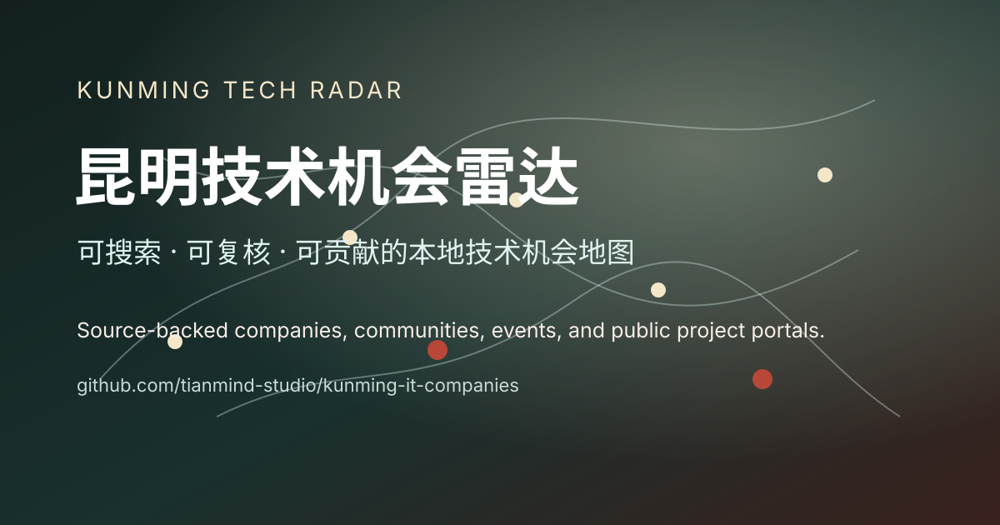

# 昆明技术机会雷达 / Kunming Tech Radar

[](https://github.com/tianmind-studio/kunming-it-companies/actions/workflows/validate.yml)
[English](README.en.md) · [在线搜索](https://kunming.tianmind.com/) · [下载 CSV](data/companies.csv) · [贡献指南](CONTRIBUTING.md)

整理昆明及云南技术公司、软件团队、社群活动和数字化项目的公开线索。每条公司记录保留来源、核验状态和日期，方便学生、开发者、自由职业者与创业者继续查证。

可以用它了解本地有哪些团队、比较技术方向、找到公开联系和研究入口。岗位、活动与合作状态请到原始来源确认；收录与检索标签不构成公司排名、就业承诺或商业背书。

## 30 秒快速入口

| 你想做什么 | 入口 |
| --- | --- |
| 搜索公司、方向、区县与核验状态 | [在线搜索](https://kunming.tianmind.com/) / [GitHub Pages 备用站](https://tianmind-studio.github.io/kunming-it-companies/) |
| 直接读公司索引 | [COMPANIES.md](COMPANIES.md) |
| 下载或接入数据 | [JSON 主数据](data/companies.json) / [CSV 导出](data/companies.csv) |
| 判断数据是否可信 | [数据质量报告](docs/data-quality-report.md) / [数据标准](docs/data-standard.md) |
| 找活动、社群和项目来源 | [社群](data/communities.csv) / [活动](data/events.csv) / [政府项目入口](data/gov-projects.csv) |
| 补充或修正公开线索 | [在线提交](https://kunming.tianmind.com/submit.html) / [GitHub Issue](https://github.com/tianmind-studio/kunming-it-companies/issues/new/choose) |
| 找到最需要复核的记录 | [数据清理计划](docs/data-cleanup-plan.md) |
| 本地运行与部署 | [本地预览](#本地预览) / [部署说明](docs/domestic-site-deploy.md) |
| 复用数据或申请更正 | [复用与引用](docs/reuse-and-citation.md) / [更正规则](docs/takedown-and-correction.md) |



## 当前数据概览

<!-- DATA_SUMMARY_START -->

数据集更新时间：`2026-09-14`。统计来自 [`data/companies.json`](data/companies.json)。

| 指标 | 当前状态 |
| --- | --- |
| 已收录公司 / 机构 | 75 |
| 官网已核验 | 26 |
| 官方页核验 | 2 |
| 社区待复核 | 47 |
| 弱来源记录 | 43 |
| 缺区县记录 | 41 |
| 强来源占比 | 37% |
| 来源种子池 | 45 条公开来源入口，覆盖 9 个方向 |

<!-- DATA_SUMMARY_END -->

**数据集更新时间不代表全部公司在当天重新核验。** 当前 73 条公司记录的 `last_checked` 仍在 2026 年 5 月；判断当前状态时，请查看具体记录的日期，并打开原始来源。完整统计与核验日期分布见[数据质量报告](docs/data-quality-report.md)。

覆盖方向包括软件开发、系统集成、AI / 大数据、农业数字化、医疗信息化、文旅科技、金融科技、网络安全和通信 / ICT。部分记录尚待补充方向或区县，收录数量不代表当地行业规模。

## 怎么判断信息可信度

| 字段 | 怎么用 |
| --- | --- |
| `source_url` / `source_urls` | 打开原始公开来源，核对主体和具体内容。 |
| `source_type` | 区分官网、官方页、政府名单、招聘平台、媒体或社区清单。 |
| `verification_status` | `verified` 为官网已核验，`official_page` 为官方页核验，`community_pending` 为待复核线索。历史核验不保证当前仍有效。 |
| `last_checked` | 这条记录最近一次核验的日期。 |
| `confidence_score` | 1–5 分的来源强度，不能用作公司好坏评分。 |
| `opportunities` / `suitable_for_*` | 检索和阅读提示，不能据此判断正在招聘、外包或寻找合作。 |

来源种子、政府门户和招聘平台搜索页都只是继续查询的入口。没有具体公告或招聘页，就不把它们当作当前机会。`community_pending`、弱来源和缺区县记录可优先补充官网、官方页、第二来源或区县证据。

## 按你的目标使用

- 学生与求职者：先看本地技术方向和已核验记录，再到公司官方渠道核实岗位与要求。
- 开发者：查团队、技术主页、开源项目和公开活动，带着作品或具体问题联系同行。
- 自由职业者与创业者：研究行业与服务方向，独立核实需求、预算和合作条件。
- 企业与社区维护者：补充官网、官方招聘页、技术博客、活动页和过期信息更正。

更详细的例子见[按角色使用](docs/use-cases.md)和[搜索指南](docs/search-guide.md)。OPC（一人公司）资源属于创业背景资料，具体政策、空间与活动的适用条件和开放状态以运营方现行公告为准。

## 本地预览

需要 **Node.js 22、npm 和 Python 3**。站点使用纯 HTML、CSS 和 JavaScript，当前没有 npm 第三方依赖；本地浏览无需数据库或账号。Python 用于预览服务器和现有 API 文件的语法检查。

```bash
git clone https://github.com/tianmind-studio/kunming-it-companies.git
cd kunming-it-companies
npm run validate
npm run serve
```

打开 [http://127.0.0.1:4178](http://127.0.0.1:4178)。`serve` 会先构建 `dist/`，再启动仅监听本机的静态服务器；按 `Ctrl+C` 停止。

```bash
npm run build:site
```

构建产物都在 `dist/`，包括首页、数据、使用指南和由已核验记录生成的公司详情页。路径同时适配站点根目录与 GitHub Pages 项目子目录。浏览器需要 JavaScript 才能搜索和筛选；JSON、CSV 与静态公司详情页可直接访问。

本地静态预览不启动线索表单 API。在线提交需要配置同域后端；仅部署静态文件时，可使用页面上的复制模板或 GitHub Issue 入口。部署配置见[国内站部署说明](docs/domestic-site-deploy.md)，实际服务状态需另行核验。

## 数据维护与贡献

公司主数据源是 `data/companies.json`。`COMPANIES.md`、`data/companies.csv`、`data/site-data.json` 及质量报告由脚本生成，不要手工修改生成内容。

修改公司 JSON 或相关 CSV 后，重新生成并校验：

```bash
npm run generate:companies
npm run export:csv
npm run generate:data-quality
npm run generate:site-data
npm run data:diff -- --base-ref origin/main
npm run validate
npm run build:site
```

`data:diff` 生成 `docs/data-change-summary.md`；提交 PR 时请附公开来源，并一并提交相关生成文件。只修改网页、文档或脚本时，运行 `npm run validate` 和 `npm run build:site`。完整字段要求和贡献流程见 [CONTRIBUTING.md](CONTRIBUTING.md)、[数据标准](docs/data-standard.md)与[字段说明](docs/data-schema.md)。

不会 GitHub 也可以通过[在线提交页](https://kunming.tianmind.com/submit.html)提供线索。只需说明名称、公开来源和需要补充或修正的事实。请勿提交第三方私人手机号、微信、聊天截图、合同、支付记录，或未经核实的薪资、裁员、加班、纠纷等信息。

## 联系 / 本地社群

昆明 / 云南本地技术社群先小规模试运行，用于交流作品、补充公开来源和复核过期记录。开发者、学生、创业者和企业负责人可通过维护者主动公开的联系入口参与。

微信号：`beizhushaonlan`


添加时请备注：`昆明技术机会雷达`。仓库不公开群二维码、其他成员的个人联系方式或聊天截图。

## 复用、引用与更正

转载或二次整理时，请保留原始来源、核验状态和 `last_checked`，并注明本项目及访问日期。请先阅读[复用与引用](docs/reuse-and-citation.md)；发现错误、过期链接、隐私信息或不适合公开的记录，可按[更正规则](docs/takedown-and-correction.md)反馈。参与讨论时请遵守[社区规范](docs/community-guidelines.md)。

本项目只整理公开信息，不保证完整、实时或绝对准确。公司、岗位、活动和项目状态会变化，使用前请向原始发布方核实。

## License

代码采用 [MIT License](LICENSE)。数据内容用于公开协作和非商业研究参考；复用时请尊重原始来源条款，保留来源链接和核验日期。
